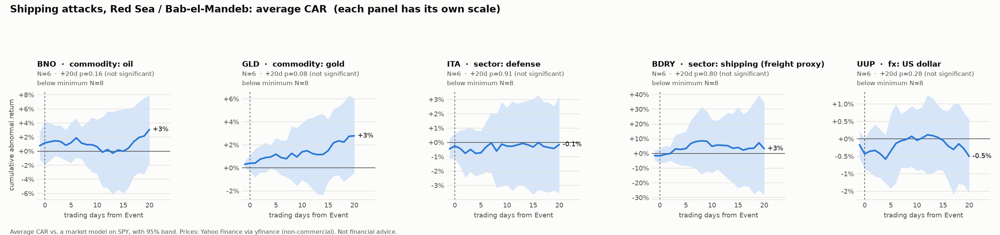
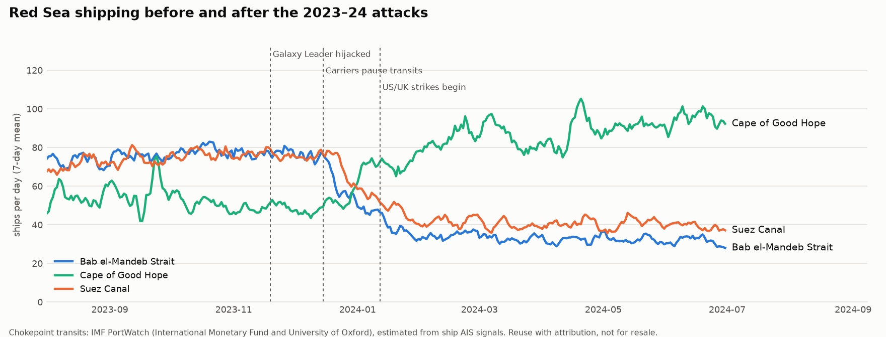

# TREMOR

**Tracking Risk Events & Market Outcome Reactions.** TREMOR turns geopolitical events into evidence about how markets react, using classic event studies (market-model abnormal returns) over comparable past events, with AI handling event classification and explanation.

> Work in progress. First slice: the Red Sea / Bab-el-Mandeb, five ETFs. See the [issues](https://github.com/bradenlocsin/tremor/issues/1).

## Results so far

The Red Sea history is complete: **5,506 Events from 2015 to Nov 2026**, grouped into **about 115 Episodes** (independent data points), from ~170,000 GDELT headlines. Full write-up in the [project log](docs/project-log.md).

- **Pre-registered shock tests (11 tests): nothing significant.** Markets didn't react differently to "worse" Red Sea events (ships damaged, energy targets, escalations). After correcting for 11 tests, every q-value is 0.955.
- **Profit search (6,720 rules, 2015 to Nov 2025): no reliable edge.** The best rule, long the defense ETF ITA for 2 days after a military strike (t = 3.6, 22 trades), passed six robustness checks but not the overfitting tests: White's Reality Check p ≈ 0.13, probability of backtest overfitting 58%. It is paper-traded as an exploratory idea ([ADR-0033](docs/adr/0033-exploratory-paper-rule.md)). The locked holdout year is untouched.
- **Live event detection:** Claude Haiku catches 75–79% of real events at 81–85% precision on the held-out test set (labels from an independent model panel, not humans; see [ADR-0025](docs/adr/0025-eval-set-labeled-by-a-codex-model-panel.md)).

### The first chart



How did markets react in the 20 trading days after Red Sea shipping attacks, beyond what the overall market explains? This early chart uses only the 6 hand-verified seed Events, too few to be statistically meaningful (the minimum is 8). Charts from the full history are next.

## Case study

**[The 2023–24 Red Sea crisis: what TREMOR would have said, and how it did](docs/case-study-red-sea.md)** (draft; back-test results pending)



## Quick start

```bash
uv sync --extra dev        # install (Python 3.12)
uv run tremor info         # show configuration
uv run pytest -m "not network"

# data
uv run tremor prices                 # daily prices (yfinance)
uv run tremor seed                   # 12 hand-verified Red Sea Events
uv run tremor gdelt backfill         # GDELT Candidates 2015 → today (hours; resumable)
uv run tremor refine --backfill      # LLM refinement (needs ANTHROPIC_API_KEY)
uv run tremor recommend              # Recommendations for the latest Episodes
uv run tremor backtest               # Track record

# dashboard (passcode-protected)
TREMOR_PASSCODE=choose-one uv run streamlit run src/tremor/dashboard/app.py
```

## Docs

- [`GLOSSARY.md`](GLOSSARY.md): the project's vocabulary
- [`docs/adr/`](docs/adr/): every design decision and why

_Not financial advice. TREMOR is an educational and portfolio project._
