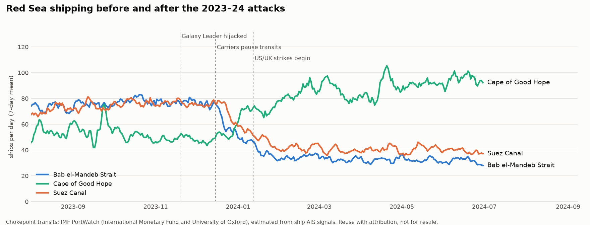
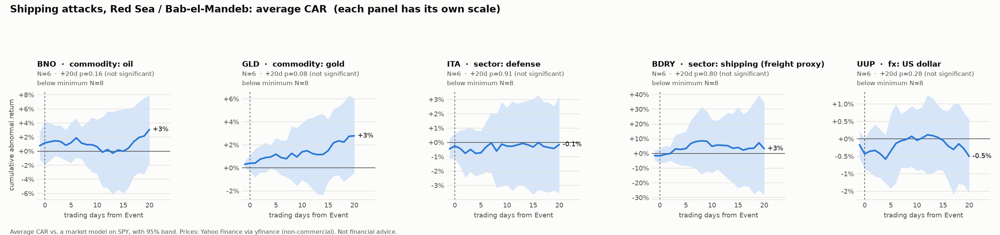

# Case study: the 2023–24 Red Sea crisis

**What TREMOR would have said, and how it did.**

> **Draft (2026-11-19).** The sections on shipping, the verified Events and the method use real data. The back-test results (the "how it did" part) are **pending**. They need the full GDELT history refined by Claude, which needs an Anthropic API key. Every number below was computed by TREMOR from the cited sources. Nothing is estimated by hand.

## The question

From November 2023, Houthi forces in Yemen attacked commercial shipping around the Bab-el-Mandeb strait, the southern gate to the Red Sea and the Suez Canal. When a shipping attack like this happens, how do oil, gold, defense stocks, freight rates and the dollar react **beyond what the overall market explains**? Could a disciplined, evidence-based tool have said something useful at the time, using only what was known then?

## What happened to shipping

Daily transits through the three chokepoints that matter here (7-day average, from IMF PortWatch's AIS-based estimates):

| | 18 Nov 2023 (before) | 25 Jan 2024 | 30 Jun 2024 |
|---|---|---|---|
| **Bab el-Mandeb** | 78/day (+2% vs. prior 90 days) | **37/day (−44%)** | 28/day |
| **Suez Canal** | 80/day (+7%) | **44/day (−38%)** | 37/day |
| **Cape of Good Hope** | 50/day (−5%) | **70/day (+30%)** | 92/day |

Traffic didn't stop. It **rerouted around Africa**, as the Cape of Good Hope numbers show. That much longer route is the economic mechanism behind the market moves TREMOR measures.

## The Events

Twelve Red Sea Events from 2015–2025 were entered by hand and checked against their cited Wikipedia articles (`config/seed_events.toml`), including:

| Date | Event | Type |
|---|---|---|
| 2023-11-19 | Houthis hijack the cargo ship *Galaxy Leader* | shipping attack |
| 2023-12-15 | Maersk and other carriers pause Red Sea transits | chokepoint disruption |
| 2024-01-12 | US and UK begin strikes on Houthi targets | military strike |
| 2024-01-26 | Missile strikes the tanker *Marlin Luanda* | shipping attack |
| 2024-02-18 | Missile strikes *Rubymar*, which later sinks | shipping attack |
| 2024-03-06 | *True Confidence* hit; first crew fatalities | shipping attack |

The full pipeline replaces this hand-picked list with GDELT's news-derived event history (2015 → today), refined by Claude, so the Comparables aren't chosen with hindsight.

## How markets reacted: a first look (hand-verified Events only)

Average **cumulative abnormal return** (CAR), meaning the return beyond what a market model on the S&P 500 (SPY) predicts, 20 trading days after the 6 hand-verified shipping attacks:

| Asset | CAR +20 days | p-value |
|---|---|---|
| Oil (BNO) | +3.07% | 0.16 |
| Gold (GLD) | +2.78% | 0.08 |
| Freight proxy (BDRY) | +3.18% | 0.80 |
| Defense (ITA) | −0.15% | 0.91 |
| US dollar (UUP) | −0.50% | 0.28 |

**None of this is statistically significant, and TREMOR says so.** With N = 6, below its minimum of 8, TREMOR shows these numbers for context but **refuses to make a Recommendation**. The direction is suggestive (oil and gold drifting up as the risk premium rises), but six events can't tell that apart from noise.

## What TREMOR would have said, and how it did

**Pending: needs the refined GDELT history.**

This section will come from `tremor backtest`. For every historical Episode start, the back-test rebuilds the Recommendation TREMOR would have made **using only Comparables and prices available the day before**, then scores it against what actually happened:

- [ ] Recommendations made at the start of each Red Sea Episode in 2023–24 (Stance, horizon, Confidence)
- [ ] Hit rate and average abnormal return earned, overall and by Confidence
- [ ] Whether High-confidence calls actually did better than Low
- [ ] Eval set accuracy of the LLM refinement step (Haiku vs. Sonnet)

## Method in one paragraph

GDELT news events are filtered to the Red Sea and to three market-relevant Event types, and Claude Haiku reads each source article to keep only real Events. Bursts of attacks are grouped into **Episodes**, and only an Episode's first Event counts as a Comparable, because markets react to the surprise, not the 27th repeat. For each Asset, an **event study** fits a market model against SPY over 120 trading days before each Comparable, measures abnormal returns for 20 days after, and tests whether their average is distinguishable from zero. A Recommendation (Overweight or Underweight) exists **only** when that test passes with at least 8 Comparables. Claude Sonnet then explains it and may lower its Confidence, but can never raise it or reverse it.

## Limitations (stated up front)

- **Prices** come from Yahoo Finance via yfinance: fine for research, not licensed for commercial use.
- **Look-ahead:** the back-test cuts off prices and Comparables before each Event, but the LLM that refines historical articles may know how things turned out from its training data. Its prompt restricts it to what each article says, but some risk remains.
- **BDRY** (the freight proxy) only exists from March 2018, so it has fewer Comparables than the other Assets.
- **GDELT** is noisy: events are coded automatically and sometimes geocoded loosely. That's why every Candidate is refined and why the Eval set exists.
- **PortWatch** transit counts are AIS-based estimates published about a week behind, not official statistics. They're used for context only, never in the Analysis.

_Not financial advice. TREMOR is an educational and portfolio project._
